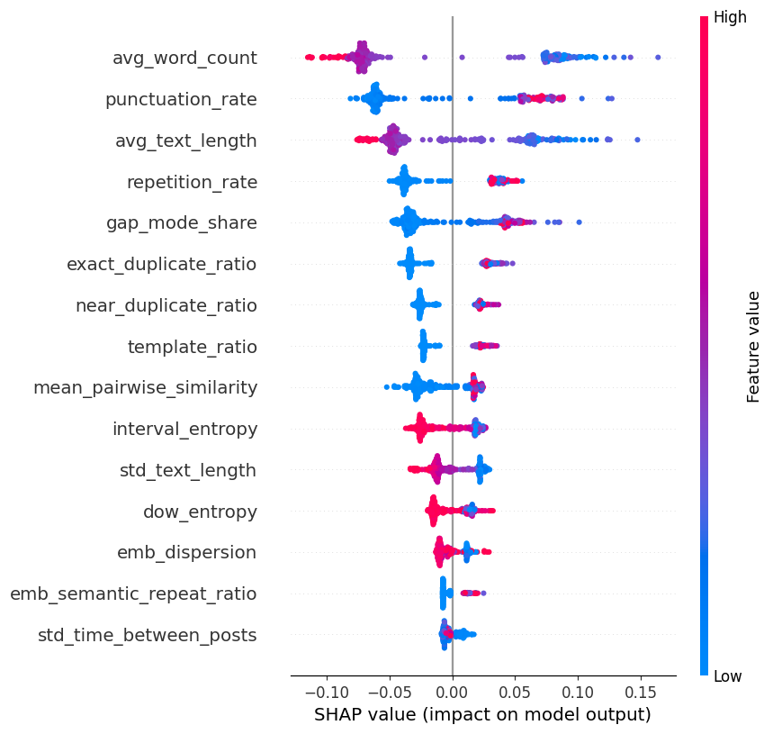
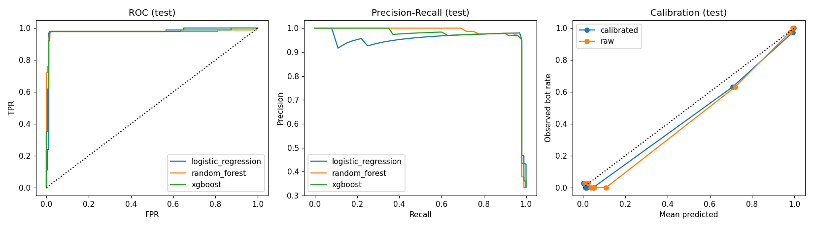
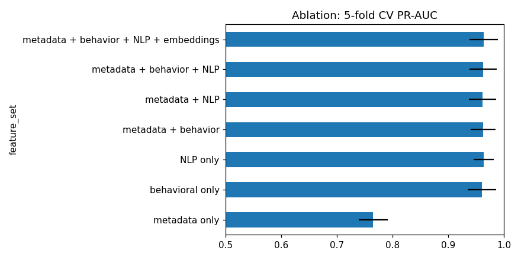

# SocialGuard AI — Experiment report (bot-detector-v1)

*Auto-generated by `python -m ml.training.train`. Data: **synthetic**.
Synthetic results demonstrate the pipeline; they are NOT evidence of real-world performance.*

## 1. Data quality
```
Total accounts              : 1,500
Valid accounts              : 1,500
Missing values accounts     : 45
Duplicate posts             : 1,201
Invalid timestamps          : 407
Empty messages              : 405
Future timestamps           : 0
Orphan posts                : 0
Total posts clean           : 120,082
```
Account-level split: train 900 / val 300 / test 300 (stratified; no account appears in two splits).
Automated-account rate: 33.3% (imbalanced → class weights, PR-AUC, threshold tuning).

## 2. Model comparison
Validation (used for selection):

| model | cv_pr_auc_train | pr_auc | roc_auc | f1 | precision | recall | brier |
|---|---|---|---|---|---|---|---|
| logistic_regression | 0.948 | 0.963 | 0.972 | 0.964 | 0.989 | 0.940 | 0.027 |
| random_forest | 0.959 | 0.979 | 0.980 | 0.960 | 0.969 | 0.950 | 0.024 |
| xgboost | 0.967 | 0.981 | 0.983 | 0.955 | 0.950 | 0.960 | 0.025 |

Test (touched once, uncalibrated @0.5):

|  | accuracy | precision | recall | f1 | roc_auc | pr_auc | brier |
|---|---|---|---|---|---|---|---|
| logistic_regression | 0.980 | 0.970 | 0.970 | 0.970 | 0.980 | 0.955 | 0.024 |
| random_forest | 0.980 | 0.961 | 0.980 | 0.970 | 0.979 | 0.981 | 0.022 |
| xgboost | 0.983 | 0.970 | 0.980 | 0.975 | 0.980 | 0.973 | 0.018 |

Selection rule: the **simplest** model whose validation PR-AUC is within 0.005 of the best → **random_forest**.

## 3. Calibration & thresholds
Method chosen by out-of-fold Brier on validation: **sigmoid** (OOF Brier {'sigmoid': 0.022010438492637233, 'isotonic': 0.02634874918107119}; uncalibrated 0.0241).
Test Brier of the calibrated model: 0.0194.

Thresholds derived on validation (not arbitrary): LOW < **0.3** ≤ MEDIUM < **0.7** ≤ HIGH.
* HIGH threshold = smallest probability with validation precision ≥ 90%.
* LOW threshold = largest probability that still captures ≥ 95% of automated accounts at or above it.
* The synthetic validation data are nearly separable, so these targets collapse into a very narrow band; the code then falls back to the documented default band 0.30/0.70 (`fallback_default_band=True` in the model metadata). Re-derive thresholds on real, noisier data.

Risk level vs. truth on test:

| risk_level | 0 | 1 |
|---|---|---|
| HIGH | 3 | 97 |
| LOW | 196 | 2 |
| MEDIUM | 1 | 1 |

Calibrated test metrics @0.5: precision 0.961, recall 0.980, F1 0.970, PR-AUC 0.981, ROC-AUC 0.979; confusion matrix [[TN,FP],[FN,TP]] = [[196, 4], [2, 98]].
At the HIGH threshold: precision 0.970, recall 0.970.

Why these metrics: with imbalanced data accuracy is misleading; **PR-AUC** summarises the precision/recall trade-off for the minority class;
**precision** = how many flagged accounts are really automated (false positives hurt real people);
**recall** = how many automated accounts are caught; **Brier/calibration** = whether "0.97" really means more than "0.51".

## 4. Experiments & ablation (same model family, different feature sets)

| feature_set | n_features | cv_pr_auc_mean | cv_pr_auc_std | test_pr_auc | test_f1 | test_roc_auc |
|---|---|---|---|---|---|---|
| metadata only | 8.000 | 0.765 | 0.026 | 0.823 | 0.737 | 0.863 |
| behavioral only | 25.000 | 0.960 | 0.026 | 0.969 | 0.960 | 0.974 |
| NLP only | 18.000 | 0.963 | 0.018 | 0.981 | 0.970 | 0.982 |
| metadata + behavior | 33.000 | 0.962 | 0.022 | 0.969 | 0.956 | 0.978 |
| metadata + NLP | 26.000 | 0.961 | 0.025 | 0.984 | 0.970 | 0.985 |
| metadata + behavior + NLP | 51.000 | 0.962 | 0.024 | 0.983 | 0.970 | 0.984 |
| metadata + behavior + NLP + embeddings | 57.000 | 0.963 | 0.025 | 0.981 | 0.970 | 0.979 |

Share of global SHAP importance by feature group: nlp 71%, behavior 23%, embeddings 5%, metadata 2%.

## 5. Global feature importance (mean |SHAP|, test)
1. `avg_word_count` — 0.077
2. `punctuation_rate` — 0.062
3. `avg_text_length` — 0.052
4. `repetition_rate` — 0.037
5. `gap_mode_share` — 0.036
6. `exact_duplicate_ratio` — 0.032
7. `near_duplicate_ratio` — 0.024
8. `template_ratio` — 0.023
9. `mean_pairwise_similarity` — 0.022
10. `interval_entropy` — 0.020
11. `std_text_length` — 0.016
12. `dow_entropy` — 0.013

  

## 6. Error analysis (test, @0.5)
False positives: 4 {'hybrid': 2, 'spam_bot': 1, 'human': 1} · False negatives: 2 {'human': 2}
· errors on deliberately-noisy labels: 5

**False positives** (humans flagged): [
 {
  "account_id": "acc_00407",
  "profile": "spam_bot",
  "bot_probability": 0.9872077010667295,
  "label_noise": 1,
  "reasons": [
   "low average word count (9.16)",
   "low average post length (65.62 chars)",
   "high share of near-identical intervals (0.39)"
  ]
 },
 {
  "account_id": "acc_00973",
  "profile": "hybrid",
  "bot_probability": 0.9842921649109823,
  "label_noise": 1,
  "reasons": [
   "low average word count (11.08)",
   "low average post length (69.03 chars)",
   "high punctuation rate (0.03)"
  ]
 },
 {
  "account_id": "acc_01458",
  "profile": "hybrid",
  "bot_probability": 0.9375869969560459,
  "label_noise": 1,
  "reasons": [
   "low average word count (10.60)",
   "low average post length (62.87 chars)",
   "high share of near-identical intervals (0.19)"
  ]
 }
]

**False negatives** (automation missed): [
 {
  "account_id": "acc_00394",
  "profile": "human",
  "bot_probability": 0.001,
  "label_noise": 1,
  "reasons": [
   "high average word count (17.66)",
   "low punctuation rate (0.02)",
   "high average post length (96.60 chars)"
  ]
 },
 {
  "account_id": "acc_01299",
  "profile": "human",
  "bot_probability": 0.0033318578805774054,
  "label_noise": 1,
  "reasons": [
   "high average word count (16.98)",
   "low punctuation rate (0.02)",
   "high average post length (95.79 chars)"
  ]
 }
]

Typical causes: `pro_human` accounts (news desks / social-media managers) post frequently and with URL-heavy content, and
`hybrid` accounts mix human and automated behaviour, so their signals overlap with the other class.

## 7. Limitations
See `docs/LIMITATIONS.md`. High frequency or regularity alone never proves automation.
